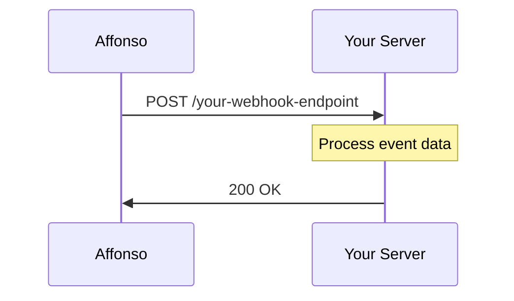

## What are Webhooks?

Webhooks allow you to receive real-time HTTP notifications when events occur in your Affonso affiliate program. Instead of polling our API for changes, webhooks push data to your server the moment something happens.

## How Webhooks Work



1. **Event occurs** - An affiliate signs up, a referral converts, a commission is paid, etc.
2. **Affonso sends a POST request** - We send a JSON payload to your configured endpoint
3. **Your server processes the event** - Handle the data as needed
4. **Respond with 200 OK** - Confirm receipt of the webhook

## Event Categories

<CardGroup cols={2}>
  <Card title="Affiliate Events" icon="user-plus" href="/webhooks/events/affiliate">
    Track when affiliates sign up, get approved, or update their details
  </Card>
  <Card title="Referral Events" icon="link" href="/webhooks/events/referral">
    Monitor referral clicks, leads, and conversions
  </Card>
  <Card title="Transaction Events" icon="receipt" href="/webhooks/events/transaction">
    Get notified about sales and commissions. Refunds are not a separate event: a full refund arrives as `transaction.rejected`, a partial refund as `transaction.updated`.
  </Card>
  <Card title="Payout Events" icon="money-bill-transfer" href="/webhooks/events/payout">
    Track affiliate payouts and payment status
  </Card>
</CardGroup>

## Security

All webhook requests include two headers for verification:

```
X-Affonso-Timestamp: 1704067200
X-Affonso-Signature: 4f2c8a1b9d3e7f0a6c5b8d1e2f3a4b5c6d7e8f9a0b1c2d3e4f5a6b7c8d9e0f1a
```

Affonso signs the string `{timestamp}.{rawBody}` with HMAC-SHA256 using your endpoint secret and sends the lowercase hex digest, without any prefix, in X-Affonso-Signature. The timestamp is sent in X-Affonso-Timestamp. Reject requests older than 5 minutes.

See [Webhook Setup](/webhooks/setup) for verification examples.

## Retry Policy

If your endpoint returns a non-`2xx` status code or does not respond within 10 seconds, the delivery is treated as failed. Affonso retries with exponential backoff for up to 48 hours, 11 attempts total. After that, the delivery is marked as failed.

## Payload Structure

All webhook payloads follow a consistent structure:

```json
{
  "id": "evt_abc123",
  "type": "referral.converted",
  "createdAt": "2024-01-15T10:30:00.000Z",
  "data": {
    // Event-specific data
  }
}
```

| Field | Description |
|-------|-------------|
| `id` | Unique event identifier |
| `type` | The event type (e.g., `affiliate.created`) |
| `createdAt` | ISO 8601 timestamp of when the event occurred |
| `data` | Event-specific payload data |

## Next Steps

<CardGroup cols={2}>
  <Card title="Set Up Webhooks" icon="gear" href="/webhooks/setup">
    Configure webhook endpoints in your dashboard
  </Card>
  <Card title="Code Examples" icon="code" href="/webhooks/examples">
    Implementation examples in various languages
  </Card>
</CardGroup>

